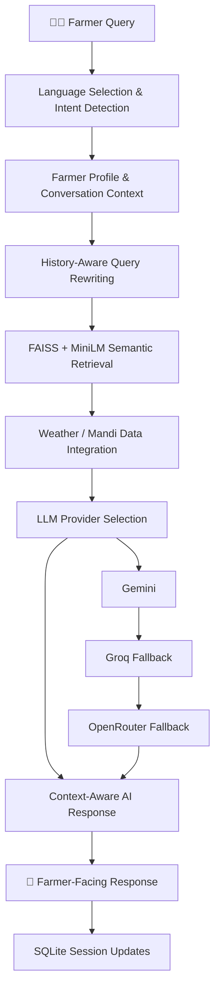

 <div align="center">

  

  # 🌾 Krishi.ai

  **Your AI-Powered Farming Companion**

  *Smarter farming decisions through multilingual AI, intelligent retrieval, and real-time agricultural insights.*

  
  
  
  
  

</div>

---

## 🌱 About Krishi.ai

**Krishi.ai** is a multilingual, multimodal AI farming assistant designed to make agricultural knowledge more accessible to Indian farmers.

Instead of relying on simple keyword-based chatbot responses, Krishi.ai combines semantic search, Retrieval-Augmented Generation (RAG), conversational context, and multiple LLM providers to deliver relevant farming guidance.

Farmers can ask questions in their preferred language, upload crop images for visual analysis, explore weather conditions, retrieve mandi prices, and receive contextual agricultural recommendations through a single conversational interface.

## ✨ Key Features

| Feature | Description |
|---|---|
| 🌍 Multilingual AI | Supports 13 Indian and international languages. |
| 🧠 Semantic RAG | FAISS-powered vector retrieval with MiniLM embeddings. |
| 💬 Contextual Conversations | History-aware query rewriting and conversation summarization. |
| 🌿 Crop Image Analysis | Gemini Vision-powered crop symptom and damage analysis. |
| 🌦️ Weather Insights | Location-based 3-day forecasts using Open-Meteo. |
| 📊 Mandi Prices | Agricultural market prices through data.gov.in/AGMARKNET when configured. |
| 📄 Dynamic Knowledge Base | Upload PDF, TXT, MD, RST, and CSV documents without restarting the application. |
| 🔄 Multi-LLM Fallback | Automatic provider fallback across Gemini, Groq, and OpenRouter. |
| 🧑‍🌾 Farmer Profiles | Maintains crop, location, soil, and irrigation information. |
| ⚡ SSE Responses | Server-Sent Events endpoint for incremental response delivery. |
| 💾 Persistent Storage | SQLite-backed profiles, session metadata, and conversation summaries. |

## 🌍 Supported Languages

Krishi.ai currently supports 13 languages:

| Language | Language Code |
|---|---|
| English | `en` |
| Hindi | `hi` |
| Marathi | `mr` |
| Kannada | `kn` |
| Tamil | `ta` |
| Telugu | `te` |
| Malayalam | `ml` |
| Gujarati | `gu` |
| Punjabi | `pa` |
| Bhojpuri | `bho` |
| Konkani | `kok` |
| Haryanvi | `ha` |
| Bengali | `bn` |

Responses are generated in the selected language to make agricultural guidance easier to understand.

## 🧠 How It Works

Krishi.ai uses a context-aware processing pipeline to understand farmer queries and generate relevant responses.



**Note:** The actual provider cascade is Gemini → Groq → OpenRouter. The diagram illustrates this fallback sequence.

## 🔬 Technical Highlights

### 1. Retrieval-Augmented Generation (RAG)

Krishi.ai uses semantic retrieval instead of relying only on keyword matching.

- Converts agricultural documents into text chunks.
- Generates embeddings using `all-MiniLM-L6-v2`.
- Stores normalized embeddings in a FAISS vector index.
- Retrieves relevant chunks using cosine similarity.
- Applies a configurable confidence threshold to filter weak matches.
- Falls back to lexical retrieval when semantic dependencies are unavailable.

### 2. Context-Aware Conversations

The application maintains conversational continuity through:

- History-aware query rewriting for short or ambiguous follow-up questions.
- Farmer profile extraction from conversation messages.
- Conversation summarization after a configurable number of turns.
- SQLite-based persistent session metadata.
- Contextual follow-up suggestions based on detected intent.

### 3. Multimodal Crop Analysis

Farmers can upload crop photographs for visual analysis using Gemini Vision.

The system examines visible symptoms such as:

- Leaf discoloration and spots.
- Pest damage and lesions.
- Wilting and unusual textures.
- Potential nutrient deficiencies or environmental stress.

It then generates possible explanations and practical next steps in the selected language.

### 4. Live Agricultural Data

**Weather:** Uses Open-Meteo geocoding and forecast APIs to retrieve location-based weather information and a 3-day forecast.

**Mandi Prices:** Integrates the data.gov.in agricultural market API to retrieve commodity prices, including minimum, maximum, and modal prices, when API credentials are configured.

### 5. Intelligent LLM Fallback

Krishi.ai uses a multi-provider architecture to improve service availability.

| Priority | Provider | Purpose |
|---|---|---|
| 1 | Google Gemini | Primary LLM provider |
| 2 | Groq | Automatic fallback |
| 3 | OpenRouter | Secondary fallback |

Provider credentials and model configurations are managed through environment variables rather than hardcoded API keys.

## 🛠️ Technology Stack

| Category | Technologies |
|---|---|
| Language | Python |
| Backend | Flask, REST APIs |
| AI & LLMs | Gemini, Groq, OpenRouter |
| Embeddings | Sentence Transformers, MiniLM |
| Vector Database | FAISS |
| Multimodal AI | Gemini Vision |
| Data Processing | NumPy, PDFMiner, PyPDF |
| Database | SQLite |
| External APIs | Open-Meteo, data.gov.in |
| Configuration | Python-dotenv |

## 🚀 Getting Started

### Prerequisites

- Python 3.10 or later.
- Git.
- API credentials for the LLM providers you intend to use.

### 1. Clone the Repository

```bash
git clone https://github.com/vrbeirer/Krishi.ai.git
cd Krishi.ai
```

### 2. Create a Virtual Environment

```bash
python -m venv venv
```

Activate it:

**Windows**
```bash
venv\Scripts\activate
```

**Linux / macOS**
```bash
source venv/bin/activate
```

### 3. Install Dependencies

```bash
pip install Flask python-dotenv requests numpy faiss-cpu sentence-transformers pdfminer.six pypdf flask-cors
```

### 4. Configure Environment Variables

Create a `.env` file in the project root.

```env
# Google Gemini
GOOGLE_API_KEY=your_gemini_api_key
GEMINI_MODEL=gemini-1.5-flash

# Groq
GROQ_API_KEY=your_groq_api_key
GROQ_MODEL=llama-3.1-8b-instant

# OpenRouter
OPENROUTER_API_KEY=your_openrouter_api_key
OPENROUTER_MODEL=nvidia/nemotron-3-ultra-550b-a55b:free

# Agricultural Market Data (Optional)
DATA_GOV_IN_API_KEY=
DATA_GOV_IN_RESOURCE_ID=

# Application Configuration
KRISHI_KNOWLEDGE_DIR=knowledge
KRISHI_DATA_DIR=data
RAG_TOP_K=5
RAG_SCORE_THRESHOLD=0.25
MAX_HISTORY_MESSAGES=8
RATE_LIMIT_PER_MIN=20
```

Keep your API credentials private. Never commit your `.env` file to GitHub.

### 5. Run the Application

```bash
python app.py
```

Open your browser:

```text
http://localhost:5000
```

## 🔌 API Endpoints

| Method | Endpoint | Description |
|---|---|---|
| GET | `/` | Main application interface |
| POST | `/chat` | Process farmer queries |
| POST | `/chat/stream` | SSE response endpoint |
| POST | `/translate` | Translate suggestions |
| POST | `/api/ingest` | Upload knowledge documents |
| GET | `/api/ingest/status` | Check knowledge base status |
| POST | `/api/analyze-image` | Analyze crop photographs |
| POST | `/api/profile` | Update farmer profile |
| GET | `/api/profile/<session_id>` | Retrieve farmer profile |
| GET | `/api/suggest/<session_id>` | Retrieve contextual suggestions |
| GET | `/health` | Application health check |
| GET | `/api/health` | Detailed backend status |

### Example: Chat API

**Request**

```http
POST /chat
Content-Type: application/json
```

```json
{
  "message": "How can I control pests in my tomato crop?",
  "language": "en",
  "history": [],
  "session_id": "farmer-session-001"
}
```

**Response**

```json
{
  "success": true,
  "response": "Here is some guidance for your tomato crop...",
  "suggestions": [],
  "sources": [],
  "session_id": "farmer-session-001",
  "intent": "pest_disease",
  "has_live_data": false,
  "fallback": false
}
```

## 📂 Project Structure

```text
Krishi.ai/
│
├── app.py                  # Flask backend and AI orchestration
├── templates/
│   └── krishi.html         # Main application interface
│
├── knowledge/              # Agricultural knowledge documents
│
├── data/                   # Runtime SQLite database and uploads
│   ├── krishi.db
│   └── uploads/
│
├── assets/
│   └── krishi-farming-hero.gif
│
├── .env                    # Private API credentials
├── .gitignore
└── README.md
```

## 🔐 Security & Reliability

- API keys are loaded from environment variables.
- File uploads have configurable size restrictions.
- Per-session request rate limiting helps control excessive requests.
- SQLite provides persistent session and profile storage.
- RAG confidence filtering helps exclude weak retrieval matches.
- AI responses use reliability instructions to discourage fabricated farming recommendations.

## ⚠️ Important Notes & Limitations

- Weather information is sourced from Open-Meteo and is not an official IMD forecast.
- Mandi price retrieval requires valid data.gov.in API credentials and a resource ID.
- Crop image analysis requires a configured Gemini API key.
- Semantic retrieval requires NumPy, FAISS, and Sentence Transformers. Otherwise, lexical retrieval is used as a fallback.
- The current SSE endpoint chunks the completed LLM response into words. It does not yet provide native token-by-token streaming from the model provider.
- Agricultural recommendations are informational. Farmers should consult their local Krishi Vigyan Kendra (KVK) or agriculture officer before making high-impact treatment decisions.

## 🔮 Future Improvements

- Speech-to-Text and Text-to-Speech for voice-based farmer interactions.
- Real-time voice conversations in regional Indian languages.
- Advanced crop disease detection and image-based recommendations.
- Improved regional crop calendars and localized advisory systems.
- Farmer-specific recommendations using historical crop and field data.
- Expanded agricultural datasets and retrieval evaluation.

## 🤝 Contributing

Contributions, suggestions, and ideas are welcome!

1. Fork the repository.
2. Create a feature branch.
3. Commit your changes.
4. Submit a pull request.

## 👨‍💻 Author

**Pranav Patil**

Generative AI Engineer | AI & LLM Applications

- [GitHub](https://github.com/vrbeirer)
- [LinkedIn](https://www.linkedin.com/in/patil04)
- [Portfolio](https://pranavp-portfolio.vercel.app/)

---

<div align="center">

  **🌾 Making agricultural knowledge accessible, one conversation at a time.**

  *Built with ❤️ for India's farming community.*

</div>
